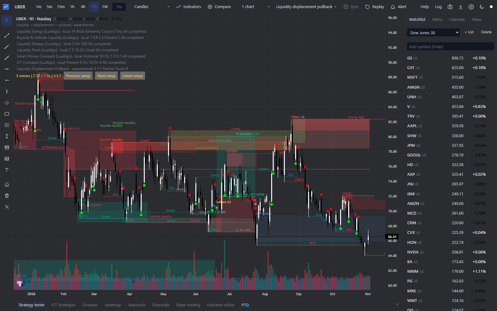
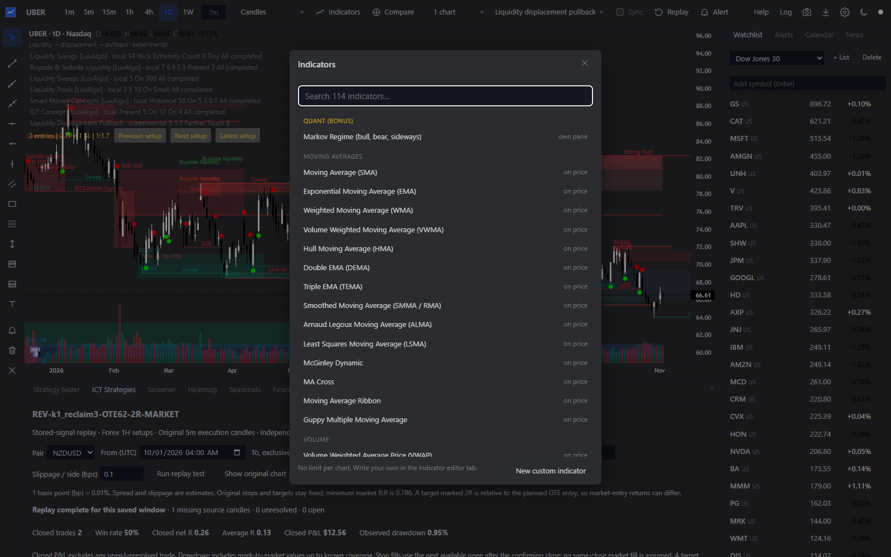

# Trading chart terminal + AI manager

A local browser charting terminal with custom ICT research indicators, plus a Codex/MCP workflow for inspecting and controlling the separately installed TradingView Desktop app.

This is an independent project based on Quant Terminal. It is not an official TradingView product.

## See the app



The browser terminal combines candlesticks, volume, drawings, watchlists, multiple timeframes and local research overlays. This screenshot shows the existing liquidity/displacement workspace on UBER. Chart annotations are research signals, not verified live orders or performance guarantees. Saved layouts and local datasets visible here are not bundled.



Use the indicator picker to add built-in or custom studies. The terminal also provides a strategy tester, bar replay, paper trading, screeners, heatmaps, calendars and an indicator editor. Data availability and delays depend on the provider.

## What is included

| Component | Purpose | Source |
|---|---|---|
| Browser terminal | Charts, indicators, drawings, replay, research backtests and paper trading | [terminal](terminal/) |
| Custom studies | Local structure, liquidity, sessions, FVG and other research overlays | [terminal/custom](terminal/custom/) |
| AI manager | Codex instructions, launch/verification scripts and MCP bridge for TradingView Desktop | [ai-manager](ai-manager/) |
| Documentation | Original terminal instructions, APIs and study definitions | [terminal docs](terminal/docs/) |

## Run the terminal

Requires Node.js 18 or newer. No npm dependencies are needed for the terminal.

```sh
cd terminal
npm start
```

Open **http://localhost:3777**. If that port is occupied, the server tries the next available port; check its startup output. To keep it running in the background:

```sh
node scripts/launch.js --no-open
```

Stop it with `node scripts/stop.js`. Optional data-feed keys belong only in your untracked `terminal/data/feeds.json`; see the [original terminal README](terminal/README.md).

## Use the AI manager

The AI manager is an agent workflow and MCP bridge, not a separate graphical dashboard. It connects Codex to the official TradingView Desktop app through local Chrome DevTools Protocol on port 9222. It does not connect to the browser clone or supply a hosted AI service.

1. Install TradingView Desktop, Node.js and Codex.
2. Install bridge dependencies:

```sh
cd ai-manager/vendor/tradingview-mcp
npm ci
```

3. On Windows, run `ai-manager/scripts/launch-tradingview-debug.bat`. The vendored bridge includes local Windows Store/MSIX discovery changes.
4. Register the MCP server with your own absolute checkout path:

```sh
codex mcp add tradingview -- node "<checkout>/ai-manager/vendor/tradingview-mcp/src/server.js"
```

5. Restart your Codex session, then run `ai-manager/scripts/verify-tradingview-codex.bat` or call the MCP health tool.

The bridge exposes chart state, quotes, indicator values, chart symbol/timeframe controls, Pine editor helpers and screenshot capture. Example requests: “Read the current chart and indicator values,” “Switch to AAPL on 1H,” and “Capture the current chart.” These capabilities require a working local Desktop/CDP connection; publishing this repository does not establish that connection.

Keep CDP bound to localhost. Broker order execution requires separate explicit authorization and setup.

## Data and research boundaries

- Credentials, broker/session data, account state, local exports, notebooks and research transcripts are excluded.
- The ICT replay panel needs separately supplied local datasets. Export scripts referencing the private ICT_Automation project are optional adapters and cannot run standalone from this repository.
- Custom studies labelled local adaptations are not claims of identical behavior to third-party indicators. Source references and limitations are documented under `terminal/docs`.
- This project does not bundle a trained AI model, an LLM API key, or a broker execution service.
- Screenshots illustrate the running local app; replay results are not evidence of live broker execution.

## Validation

The packaged terminal passed `npm test`: **196 tests, 196 passed**. Run it from `terminal/`. The live local app returned HTTP 200 and a healthy `/api/health` response. AI manager unit validation is recorded in [VALIDATION.md](docs/VALIDATION.md).

## Credits and licenses

- Quant Terminal: copyright Lewis Jackson, MIT. See [LICENSE](terminal/LICENSE) and [NOTICE](terminal/NOTICE).
- TradingView Lightweight Charts: Apache 2.0; attribution and the bundled license are retained under `terminal/public/vendor`.
- TradingView MCP: [tradesdontlie/tradingview-mcp](https://github.com/tradesdontlie/tradingview-mcp), MIT; [license](ai-manager/vendor/tradingview-mcp/LICENSE) retained with local changes.

Existing component licenses govern their respective source files. TradingView and other product names belong to their owners. This repository is not affiliated with or endorsed by TradingView.
